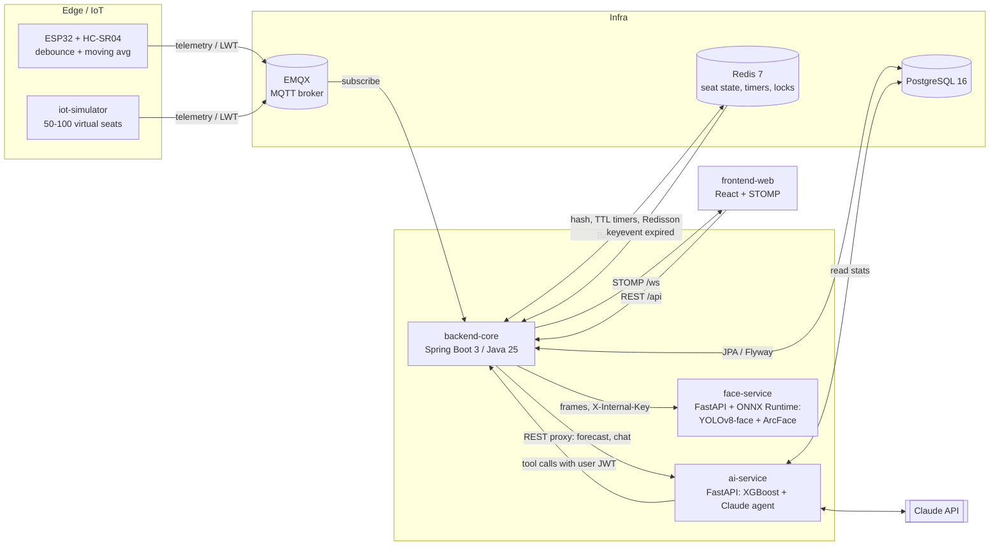
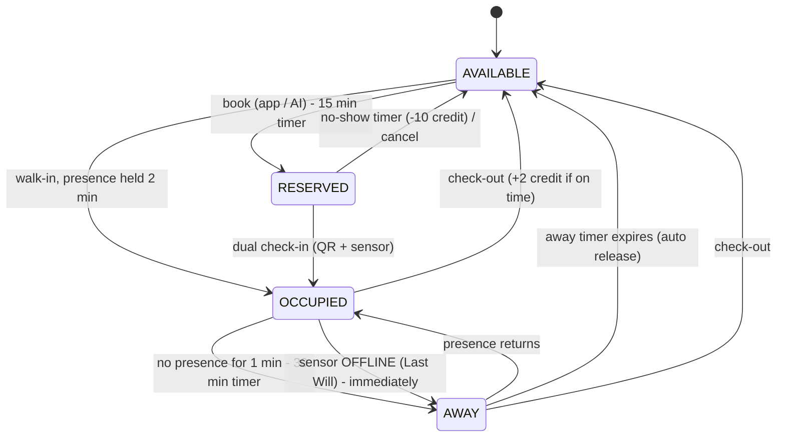
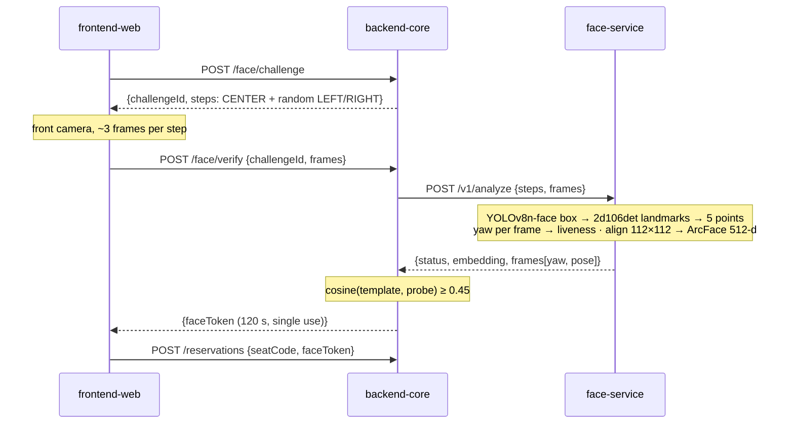

# Architecture

## Seat state machine

## Redis keys

| Key | Type | TTL | Meaning |
|---|---|---|---|
| `lock:seat:booking:{seat_code}` | Redisson lock | 5 s lease | serialises all transitions of one seat |
| `seat:state:{seat_code}` | hash | — | `seatId, zoneCode, status, physicalOccupied, lastDistanceCm, currentUserId, currentReservationId, stateUpdatedAt` |
| `timer:reservation:expire:{reservation_id}` | string | 900 s | no-show deadline |
| `timer:seat:away:{seat_code}` | string | 1800 s | away deadline |
| `timer:seat:walkin:{seat_code}` | string | 120 s | presence must hold this long to become a walk-in |
| `timer:seat:awaypending:{seat_code}` | string | 60 s | absence must hold this long to become AWAY |
| `cache:forecast:zone:{zone_code}:{YYYY-MM-DD}` | JSON string | 3600 s | forecast cache |
| `face:challenge:{id}` | string `userId\|CENTER,LEFT,RIGHT` | 90 s | head-turn challenge, spent by one enrol/verify |
| `face:token:{token}` | string userId | 120 s | proof of a passed face check, spent by one booking |
| `face:fail:{user_id}` | counter | 600 s | liveness/match failures; 5 → `FACE_VERIFY_LOCKED` |

A seat whose sensor goes OFFLINE is treated as empty: OCCUPIED moves to AWAY immediately, and the away timer releases it unless the device comes back and detects the student. The same check runs at startup for devices that died while the backend was down.

Redis expiry events are best-effort (they can fire late and are lost while the backend is down), so a reconciliation job in backend-core re-checks deadlines from PostgreSQL every 30 s.

## Face verification before booking

- **Why two models:** YOLO only *detects* faces (where), it cannot tell *who*. ArcFace turns the aligned face into an
  identity embedding; same person ≈ 0.6–0.95 cosine, different people < 0.25 on our checks.
- **Liveness:** the student turns the head in a random order. A printed photo or a phone screen rotated in front of the
  camera keeps the nose on the eye midline (no parallax), so the yaw never reaches the "turned" threshold; all frames
  must also belong to the same face. A pre-recorded video with the same random order could still pass – documented limitation.
- **Privacy:** face-service is stateless and not exposed on the host; only the 512-d template (2 KB `bytea`) is stored,
  with the consent time (Decree 13/2023/ND-CP). `ai_reader` is denied access to `face_profiles`. Students can delete it.
- **Enrolment:** self-service on the first booking, once; replacing it needs a librarian reset. In production, enrolment
  would happen at the library desk against the student card, since a self-enrolled face only proves "same person as at enrolment".
- `FACE_VERIFY_ENABLED=false` turns the whole check off (bookings need no token).
