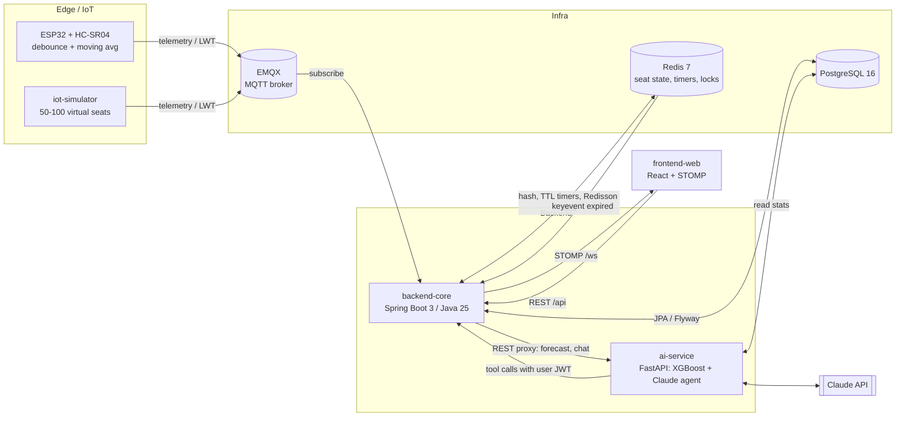
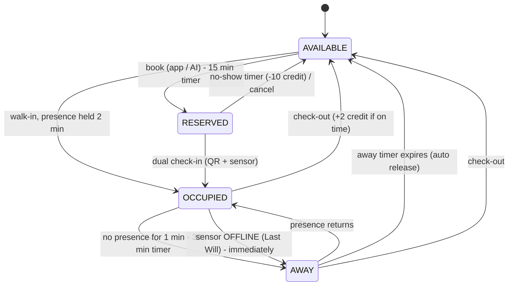

# Architecture

## Seat state machine

## Redis keys

| Key | Type | TTL | Meaning |
|---|---|---|---|
| `lock:seat:booking:{seat_code}` | Redisson lock | 5 s lease | serialises all transitions of one seat |
| `seat:state:{seat_code}` | hash | — | `seatId, zoneCode, status, physicalOccupied, lastDistanceCm, currentUserId, currentReservationId, stateUpdatedAt` |
| `timer:reservation:expire:{reservation_id}` | string | 900 s | no-show deadline |
| `timer:seat:away:{seat_code}` | string | 1800 s | away deadline |
| `timer:seat:walkin:{seat_code}` | string | 120 s | presence must hold this long to become a walk-in |
| `timer:seat:awaypending:{seat_code}` | string | 60 s | absence must hold this long to become AWAY |
| `cache:forecast:zone:{zone_code}:{YYYY-MM-DD}` | JSON string | 3600 s | forecast cache |

A seat whose sensor goes OFFLINE is treated as empty: OCCUPIED moves to AWAY immediately, and the away timer releases it unless the device comes back and detects the student. The same check runs at startup for devices that died while the backend was down.

Redis expiry events are best-effort (they can fire late and are lost while the backend is down), so a reconciliation job in backend-core re-checks deadlines from PostgreSQL every 30 s.
